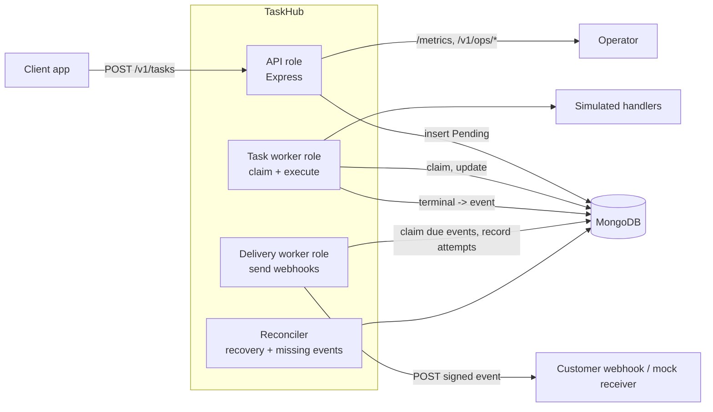
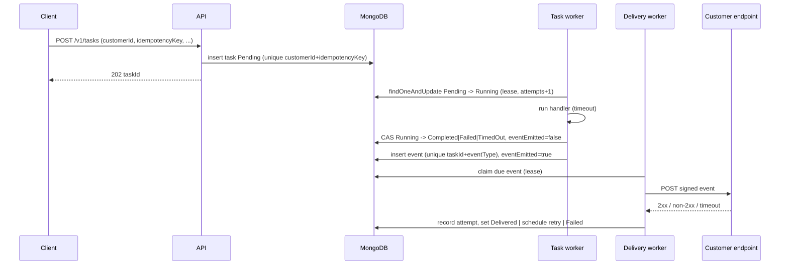

# TaskHub — Architecture

Status: DRAFT v0.2 — Express chosen, MongoDB-only queue confirmed; awaiting final approval
Inputs: [PRD.md](PRD.md), [task_prompt.md](task_prompt.md); future work: [IMPROVEMENTS.md](IMPROVEMENTS.md)

## 1. Tool choices

| Concern | Choice | Why |
| --- | --- | --- |
| Runtime | Node.js 24 LTS (or newer) | Requested stack |
| Language | TypeScript | Typed schemas for documents, states, and events; fewer lifecycle bugs |
| HTTP framework | Express 5 | Familiar, native async handler support, simple middleware for correlation ID and request timing |
| Validation | zod | One schema gives runtime validation and TypeScript types (requests, config, handler payloads) |
| Database | MongoDB (local, `MONGODB_URI`) with Mongoose 9 | Requested; typed schemas with validation and declared indexes. Hot paths use `findOneAndUpdate` (with `.lean()`) for atomic claims/CAS; `versionKey`, `timestamps` and `autoIndex` are off, indexes are created explicitly at startup |
| Logging | winston (JSON) | Structured logs; `logger.child({...})` carries `correlationId`, `taskId`, `customerId`, `eventId`; custom redaction format masks secrets; request-logging middleware written in-house |
| Metrics | prom-client (`/metrics`) + custom JSON summary endpoint | Prometheus histograms for live technical metrics; exact percentiles from persisted timestamps for the summary |
| Webhook HTTP client | Node built-in `fetch` (undici) with `AbortSignal.timeout` | No extra dependency, per-attempt timeout |
| Signing | Node `crypto` HMAC-SHA256 | Standard webhook signature scheme |
| Tests | Vitest | Fast, TypeScript-native; unit tests mock repositories and clock, integration tests use a separate test database on local MongoDB |
| Mock webhook receiver | Small Express app in `scripts/` | Controllable modes: ok, fail-N-times, always-500, slow, drop |
| Demo driver | Node script | Runs the scenarios from PRD section 6 and prints evidence |

Deliberately not used: Docker, Redis/BullMQ/Kafka (MongoDB is the only infrastructure and acts as the queue; Redis-based queueing is listed in [IMPROVEMENTS.md](IMPROVEMENTS.md)), OpenTelemetry (correlation IDs in logs and records provide the required tracing; OTel can be layered on later).

## 2. Component overview

One codebase, three roles that can run in the same process or separately (`ROLES=api,worker,delivery`).



| Component | Responsibility |
| --- | --- |
| API | Validate, idempotent insert, return `202`; status/list/events/ops/metrics endpoints; correlation ID and request metrics middleware |
| Task worker | Poll and atomically claim due `Pending` tasks; run handler with timeout via `AbortController`; CAS transition to terminal or back to `Pending` with backoff |
| Delivery worker | Poll and atomically claim due events; sign and POST; record each attempt; schedule retry or mark `Delivered`/`Failed` |
| Reconciler | Periodic: (a) expired `Running` leases back to `Pending` or terminal, (b) terminal tasks with `eventEmitted=false` get their event created, (c) events stuck in a delivery lease are released |
| Handlers | `document_processing`, `report_generation`, `data_sync`: simulated duration/failure driven by payload hints (e.g. `simulate: {durationMs, failure: 'retryable'|'fatal'|'hang'}`) |

### Core flows

Submission and execution:



Key mechanisms:

- **Idempotency:** unique index on `(customerId, idempotencyKey)`. Insert; on duplicate-key error read the existing task, compare `payloadHash`+`taskType`: equal returns it (`200`), different returns `409`. Safe under concurrent duplicates.
- **Atomic claim:** `findOneAndUpdate({status:'Pending', nextRunAt<=now}, {status:'Running', lease, $inc attempts})` sorted by `nextRunAt`; only one worker wins a task.
- **Timeout:** worker aborts the handler at `timeoutMs`. Every completion write is a CAS on `{_id, status:'Running', attempts: n, lease.workerId}`, so a late result from an abandoned attempt is ignored.
- **Lease and recovery:** `lease.expiresAt = now + timeoutMs + grace`. No heartbeat needed. After a crash the reconciler requeues expired leases (or goes terminal if attempts are exhausted).
- **Retry/backoff:** `nextRunAt = now + min(cap, base * 2^(attempts-1)) + jitter`, same formula for webhook delivery.
- **No transactions:** terminal task write and event insert are two steps. Crash between them leaves `eventEmitted=false`; the reconciler creates the event, and the unique `(taskId, eventType)` index makes the insert idempotent.
- **Webhook duplicates:** at-least-once; stable `eventId`, `X-TaskHub-Event-Id`, and signed timestamp for receiver-side dedup and replay protection.
- **Graceful shutdown:** stop claiming, let in-flight work finish within a deadline, otherwise leases expire and the reconciler recovers.

## 3. MongoDB schema

Three collections. `_id` values are prefixed string IDs (`tsk_`, `evt_`) using `crypto.randomUUID()`. Mongoose schemas live in `src/db/schemas.ts`.

### 3.1 `customers`

| Field | Type | Notes |
| --- | --- | --- |
| `_id` | string | The `customerId` |
| `webhook.url` | string | Default webhook URL (https; http only in demo mode) |
| `webhook.secret` | string | HMAC signing secret; never logged or returned after set |
| `createdAt`, `updatedAt` | Date | |

Customers are created lazily: submitting a task for an unknown `customerId` works (no webhook, events are `Skipped`); configuring a webhook upserts the record.

### 3.2 `tasks`

| Field | Type | Notes |
| --- | --- | --- |
| `_id` | string | `taskId` |
| `customerId` | string | |
| `taskType` | enum | `document_processing`, `report_generation`, `data_sync` |
| `payload` | object | Validated, size-limited |
| `payloadHash` | string | SHA-256 of canonical JSON of `taskType`+`payload`, for idempotency comparison |
| `idempotencyKey` | string | |
| `status` | enum | `Pending`, `Running`, `Completed`, `Failed`, `TimedOut` |
| `attempts` | int | Number of started attempts |
| `maxAttempts` | int | Default 3 |
| `timeoutMs` | int | Per-attempt timeout |
| `slaMs` | int | SLA turnaround target for this task type |
| `webhookUrl` | string or null | Per-task override |
| `correlationId` | string | From header or generated |
| `nextRunAt` | Date | Earliest time it may be claimed (backoff) |
| `lease` | `{workerId, expiresAt}` or null | Set while `Running` |
| `result` | object or null | When `Completed` |
| `error` | `{code, message, retryable}` or null | When `Failed`/`TimedOut` |
| `attemptLog[]` | `{n, workerId, startedAt, finishedAt, outcome, error?}` | Bounded by `maxAttempts`; source for execution-duration metrics |
| `history[]` | `{from, to, at, reason}` | State transition audit trail |
| `eventEmitted` | bool | `false` set on terminal transition until event is inserted |
| `createdAt`, `updatedAt` | Date | |
| `firstStartedAt`, `finishedAt` | Date or null | Queue wait = `firstStartedAt - createdAt`; turnaround = `finishedAt - createdAt` |

Indexes:

| Index | Purpose |
| --- | --- |
| `{customerId:1, idempotencyKey:1}` unique | Idempotency |
| `{status:1, nextRunAt:1}` | Claim due tasks |
| `{status:1, 'lease.expiresAt':1}` | Recovery of expired leases |
| `{eventEmitted:1}` partial (`eventEmitted:false`) | Reconciler finds missing events |
| `{customerId:1, createdAt:-1}` | Listing, tasks per customer |
| `{finishedAt:1}` | Metrics windows |

### 3.3 `events` (notification + delivery record)

One document per event, holding both the event and its delivery state, so task outcome and delivery outcome are tracked separately.

| Field | Type | Notes |
| --- | --- | --- |
| `_id` | string | `eventId`, stable across retries |
| `taskId`, `customerId` | string | |
| `eventType` | enum | `task.completed`, `task.failed`, `task.timed_out` |
| `correlationId` | string | Copied from task |
| `body` | object | Exact JSON sent: `eventId, eventType, taskId, customerId, timestamp, data, correlationId` |
| `url` | string or null | Resolved URL snapshot (task override, else customer default) |
| `createdAt` | Date | |
| `delivery.status` | enum | `Pending`, `Delivered`, `Failed`, `Skipped` |
| `delivery.attemptCount`, `delivery.maxAttempts` | int | Default max 6 |
| `delivery.nextAttemptAt` | Date | |
| `delivery.lease` | `{workerId, expiresAt}` or null | |
| `delivery.attempts[]` | `{n, startedAt, durationMs, statusCode?, error?, responseSnippet?}` | One entry per attempt |
| `delivery.deliveredAt` | Date or null | End-to-end latency = `deliveredAt - task.finishedAt` |
| `delivery.lastError` | string or null | |

Indexes:

| Index | Purpose |
| --- | --- |
| `{taskId:1, eventType:1}` unique | Exactly one event per task outcome |
| `{'delivery.status':1, 'delivery.nextAttemptAt':1}` | Claim due deliveries |
| `{'delivery.status':1, 'delivery.lease.expiresAt':1}` | Release stuck leases |
| `{customerId:1, createdAt:-1}` | Operator lookups |

### 3.4 Retention

Out of scope for v1; optional TTL index on terminal `tasks`/`events` can be added later.

## 4. API surface

| Method and path | Purpose |
| --- | --- |
| `POST /v1/tasks` | Submit (`202` new, `200` duplicate, `409` key conflict) |
| `GET /v1/tasks/:taskId` | Status, result, failure details, attempts |
| `GET /v1/tasks` | List by `customerId`, `status`, pagination |
| `PUT /v1/customers/:customerId/webhook` | Set default URL and secret |
| `GET /v1/tasks/:taskId/events` | Events and delivery attempts for a task |
| `GET /v1/deliveries?status=` | Operator view of deliveries (e.g. `Failed`) |
| `POST /v1/deliveries/:eventId/retry` | Replay a `Failed` delivery |
| `GET /v1/ops/tasks/:taskId/investigation` | Single call: task, history, attempts, events, delivery attempts |
| `GET /v1/ops/metrics/summary?window=` | JSON business and technical metrics with p50/p96/p99 |
| `GET /metrics` | Prometheus exposition |
| `GET /healthz` | Liveness and Mongo connectivity |

## 5. Metrics implementation

- Live technical metrics (API rate/errors/latency, active workers, webhook attempt latency) use prom-client counters, gauges, and histograms. Percentiles are approximated from histogram buckets.
- The summary endpoint computes exact percentiles (nearest-rank on p50, p96, p99) in the application from persisted timestamps (`tasks.attemptLog`, `tasks.finishedAt`, `events.delivery.attempts`, `events.delivery.deliveredAt`) within the requested window. This avoids depending on the MongoDB version (`$percentile` needs 7.0+) and fits demo scale.
- Each metric response states its definition, unit, and window, matching the table in the PRD.
- Pending/active counts are live gauges from `countDocuments` on indexed status fields.

## 6. Logging and correlation

- Every log line is JSON with `timestamp, level, msg, service, role` plus `correlationId`, `taskId`, `customerId`, `eventId`, `attempt` where applicable.
- `correlationId` is read from `X-Correlation-Id` (or generated), stored on the task, copied to the event, and sent in webhook headers (`X-TaskHub-Correlation-Id`).
- Logged events: request completed, task submitted/duplicate, state transition, attempt started/finished, event created, delivery attempt result, reconciler actions.
- Secrets and payload bodies are not logged.

## 7. Project layout

Code is split by module (feature). Each module owns its constants, types, Mongoose model, repository, service, controller, routes and utilities, and exposes a small public API through its `index.ts`. Code used by several modules lives in `shared/`.

```
task_hub/
  docs/                         PRD, architecture, improvements, task prompt
  src/
    index.ts                    bootstrap: config, DB, roles, graceful shutdown
    app.ts                      Express composition (global middleware + module routers)
    config/                     env parsing and typed config (zod)
    database/                   Mongoose connection, model registry, index creation
    observability/              winston logger + redaction (later: prom metrics, percentiles)
    shared/
      errors/                   AppError, ValidationError, NotFoundError
      http/                     request context, correlation / request-log / error middleware
      database/                 shared schema options and sub-schemas (lease)
      types/                    Json types, Lease
      utils/                    backoff, ids, canonicalJson, zod helpers, mongo error helpers
    modules/
      tasks/                    task.constants / types / model / stateMachine / errors / utils
                                task.validation / repository / service / controller / routes / view, index.ts
      events/                   event.constants / types / model / utils (delivery logic lands in slice 5)
      customers/                customer.types / model (webhook config API lands in slice 5)
      webhooks/                 webhookUrl validation (signing and delivery land in slice 5)
      health/                   health controller / routes
      (worker, reconciler, delivery, metrics, ops modules are added in later slices)
  scripts/                      mock-webhook-receiver, demo (later slice)
  test/
    unit/                       mirrors src/ (shared, config, database, observability, modules/<name>)
    integration/                mirrors src/ against a local Mongo test database
    mocks/                      global helpers (config, logger capture, test DB) and per-module mocks (mocks/tasks)
```

Conventions: modules never import from `database/` (it imports their schemas); a module may import another module's public API or constants only in the direction tasks -> events -> webhooks/customers, never the reverse; controllers are thin (parse, call service, shape response); services hold business rules and depend on repository interfaces so unit tests use in-memory fakes.

## 8. Implementation slices (each ends with unit tests run and your review)

1. Project scaffold: config, logger, Mongo client, indexes, domain types, state machine, backoff (+ unit tests)
2. Task submission API with idempotency (+ unit/integration tests)
3. Task worker: claim, handlers, timeout, retry, terminal transitions (+ tests)
4. Reconciler: lease recovery and event creation (+ tests)
5. Webhook: customer config, event creation, delivery worker, signing, attempt records (+ tests)
6. Retrieval and operator endpoints (+ tests)
7. Metrics and observability (+ tests)
8. Mock receiver, demo script, README

## 9. Risks and trade-offs

| Topic | Trade-off |
| --- | --- |
| MongoDB as queue | Polling adds latency (interval about 500 ms) and load; acceptable at demo scale, replaceable by a broker later |
| No transactions | Handled by CAS writes, unique indexes, and reconciler; brief window where a terminal task has no event yet |
| At-least-once execution | A crash mid-handler can re-run it; handlers must be idempotent |
| Exact percentiles in app | Loads window samples into memory; fine for demo, would move to pre-aggregation at scale |
| Timeout of simulated handlers | Real handlers must honor `AbortSignal`; the worker still ignores late results via CAS |
