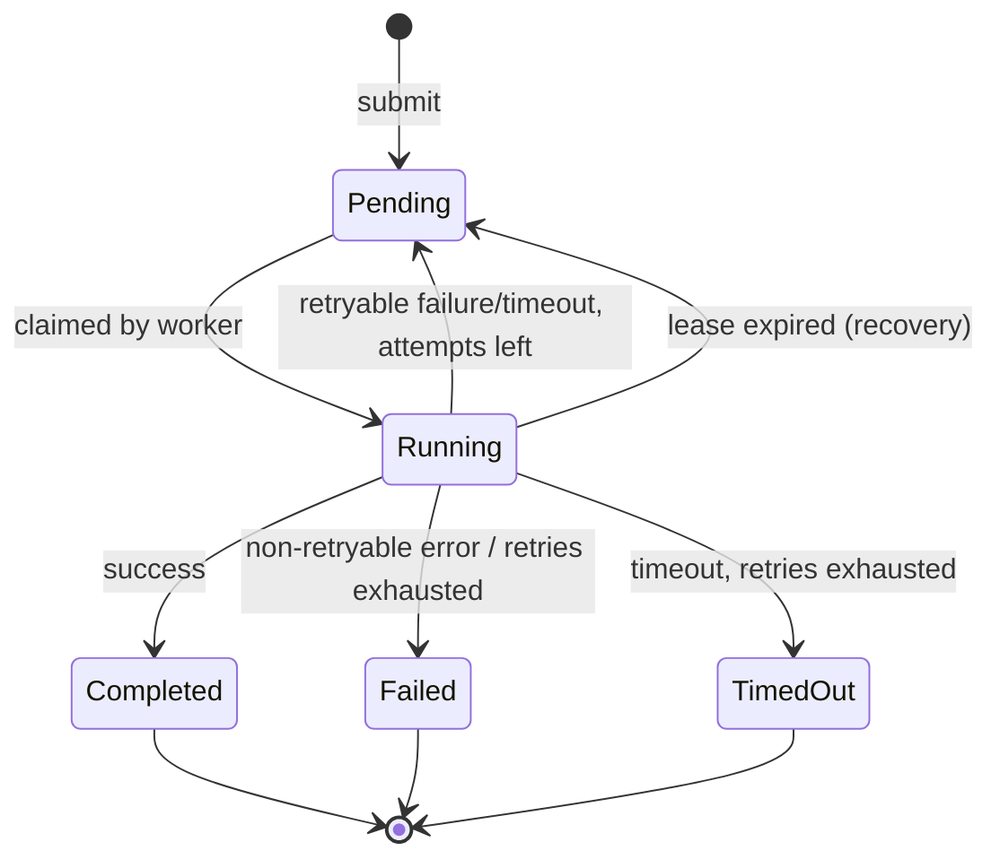

# TaskHub — Product Requirements Document

Status: v0.2 — review answers incorporated, awaiting final approval
Source: [task_prompt.md](task_prompt.md)

## 1. Purpose

TaskHub is a multi-customer service that accepts long-running operations (document processing, report generation, data synchronization), executes them asynchronously, exposes status/results, and notifies customers by webhook when execution ends. It provides evidence of execution, notification, customer experience, and platform reliability.

## 2. Goals and Non-Goals

Goals
- Non-blocking submission that returns a task ID immediately.
- Reliable, persisted, restart-safe asynchronous execution with retries and timeouts.
- Reliable webhook notification with per-attempt records and operator visibility.
- Technical and business metrics with p50/p96/p99 latencies.
- Correlated diagnostics across submission, execution, and webhook delivery.

Non-Goals (assumptions — please confirm)
- No real document/report/sync logic: task types are simulated handlers (configurable duration and failure behavior).
- No UI; REST API + CLI/scripts for the demo.
- No authentication/billing: customers are identified by a plain string `customerId` in the request body (no API keys). Real auth is a future addition.
- No Docker: runs against a local MongoDB via `MONGODB_URI`.
- No horizontal multi-region deployment; design must not prevent running multiple worker processes.

## 3. Users

| User | Needs |
| --- | --- |
| Client application | Submit task, poll status/result, receive webhook |
| Customer admin | Configure webhook URL and secret |
| Operator | Investigate a task and its webhook deliveries, view metrics |

## 4. Functional Requirements

### 4.1 Task submission
- FR-1: `POST /v1/tasks` accepts `taskType`, `payload`, `customerId`, `idempotencyKey` and optional `webhookUrl` (per-task override); returns `202 Accepted` with `taskId` and status without waiting for execution. One customer can submit any number of tasks.
- FR-2: Supported `taskType`: `document_processing`, `report_generation`, `data_sync`. Unknown types are rejected with `400`.
- FR-3: Idempotency scope is `(customerId, idempotencyKey)`.
  - Same key + same payload/type: return the original task (`200`, same `taskId`), no new task.
  - Same key + different payload/type: `409 Conflict`.
  - Concurrent duplicates must yield exactly one task (enforced by a unique index, not by check-then-insert).
- FR-4: Payload size limit and schema validation per task type.

### 4.2 Execution
- FR-5: Accepted tasks are persisted before the `202` is returned, then executed asynchronously by workers.
- FR-6: Multiple workers may run concurrently; a task is claimed by exactly one worker at a time (atomic claim).
- FR-7: Each execution attempt has a timeout (default configurable per task type). Exceeding it ends the attempt as timed out.
- FR-8: Retries: failed or timed-out attempts are retried up to `maxAttempts` (default 3) with exponential backoff and jitter. Handlers signal retryable vs non-retryable errors; non-retryable errors fail immediately.
- FR-9: Restart recovery: tasks left `Running` with an expired lease are returned to `Pending` (or terminal if attempts exhausted) on startup and periodically. Pending tasks are picked up after restart. No task is lost; at-least-once execution, so handlers must be idempotent.

### 4.3 Task lifecycle

Baseline states: `Pending`, `Running`, `Completed`, `Failed`. One added state, justified below.

| State | Terminal | Meaning |
| --- | --- | --- |
| Pending | No | Accepted, waiting to run (including waiting for retry backoff; tracked via `attempts` and `nextRunAt`) |
| Running | No | Claimed by a worker, lease held |
| Completed | Yes | Finished successfully, result stored |
| Failed | Yes | Terminal failure after non-retryable error or retries exhausted, error details stored |
| TimedOut (added) | Yes | Final attempt exceeded the execution timeout |

Justification for `TimedOut`: the prompt requires a distinct `task.timed_out` event and timeout metrics; a separate state avoids overloading `Failed` and keeps customer-facing semantics clear. A `Retrying` state is deliberately NOT added; `Pending` with `attempts > 0` covers it.

Valid transitions:

All other transitions are rejected; terminal states are immutable. Transitions use conditional (compare-and-set) updates and append to a task history.

### 4.4 Status and result retrieval
- FR-10: `GET /v1/tasks/:taskId` returns state, timestamps, attempt count, and result (if Completed) or failure details (error code, message, attempt history) if Failed/TimedOut.
- FR-11: `GET /v1/tasks?customerId=&status=` lists tasks with pagination. Customers can only see their own tasks.

### 4.5 Webhook notifications
- FR-12: Customer default webhook URL (and signing secret) is configured per customer via `PUT /v1/customers/:customerId/webhook`; a task may override the URL at submission. Resolution order: task `webhookUrl`, then customer default, else `Skipped`. The resolved URL is snapshotted on the event. URL must be `https` (http allowed only in local/demo mode) and must not resolve to private/loopback addresses outside demo mode (SSRF protection).
- FR-13: On terminal state, publish `task.completed`, `task.failed`, or `task.timed_out`. No multi-document transactions are used: the task is marked `eventEmitted=false` in its terminal transition, the event is created with a unique `(taskId, eventType)` key, and a reconciler creates any missing event, so a terminal task can never lose its event.
- FR-14: Event payload: `eventId`, `eventType`, `taskId`, `customerId`, `timestamp`, `data` (status, result summary or error, attempts, durations), `correlationId`.
- FR-15: Delivery is asynchronous by a separate delivery worker. Every attempt is recorded: attempt number, start time, duration, HTTP status or network error, response snippet.
- FR-16: Success = HTTP `2xx` within the delivery timeout. Non-2xx, timeouts, and network errors are retried with exponential backoff up to `maxDeliveryAttempts` (default 6); `410`/permanent `4xx` (except `408`, `429`) stop retries early. After exhaustion, delivery is `Failed` (dead-lettered, replayable by operator).
- FR-17: Duplicate delivery risk: delivery is at-least-once. Events carry a stable `eventId` (same across retries) in the body and `X-TaskHub-Event-Id` header so receivers can deduplicate. Payload is signed (`X-TaskHub-Signature`, HMAC-SHA256 with timestamp).
- FR-18: Delivery states: `Pending`, `Delivered`, `Failed` (exhausted). Delivery state is tracked separately from task state.
- FR-19: Operator endpoints: `GET /v1/tasks/:taskId/events` (events + delivery status + attempts), `GET /v1/deliveries?status=failed`, `POST /v1/deliveries/:eventId/retry` (manual replay).
- FR-20: If a customer has no webhook configured, events are recorded with delivery status `Skipped`.

### 4.6 Metrics and observability
- FR-21: `GET /metrics` (Prometheus format) plus `GET /v1/ops/metrics/summary` (JSON with percentiles and business figures for a requested window).
- FR-22: Latency metrics report p50, p96, p99 (p96 is used as written in the source requirements).
- FR-23: Structured JSON logs on every request, state transition, execution attempt, and delivery attempt, carrying `correlationId`, `taskId`, `customerId`, `eventId` where applicable.
- FR-24: Correlation: `correlationId` is taken from the `X-Correlation-Id` header or generated at submission, stored on the task, and propagated to execution logs, events, and webhook headers.

Metric definitions (initial; targets are proposals):

| Metric | Type | Definition | Unit | Window |
| --- | --- | --- | --- | --- |
| API request rate | Technical | Requests received per route | req/s | Rolling 1 min (also queryable 5m/1h) |
| API error rate | Technical | 5xx responses / total requests (4xx reported separately) | % | Rolling 5 min |
| API latency p50/p96/p99 | Technical | Request received to response sent, per route | ms | Rolling 5 min |
| Queue wait time p50/p96/p99 | Technical | `startedAt` of first attempt minus `createdAt` | ms | Rolling 5 min |
| Execution duration p50/p96/p99 | Technical | Per attempt, `startedAt` to `finishedAt`, per task type | ms | Rolling 5 min |
| Pending / active task count | Technical | Tasks in Pending / Running now (gauge) | count | Instantaneous |
| Webhook attempt latency p50/p96/p99 | Technical | HTTP request sent to response received | ms | Rolling 5 min |
| Webhook attempts per event | Technical | Attempts until delivered or exhausted | count (avg, max) | Rolling 1 h |
| Webhook failure rate | Technical | Failed attempts / total attempts | % | Rolling 5 min |
| Completion rate | Business | Completed / terminal tasks | % | Rolling 1 h / 24 h |
| Terminal failure rate | Business | (Failed + TimedOut) / terminal tasks | % | Rolling 1 h / 24 h |
| Turnaround time p50/p96/p99 | Business | `createdAt` to terminal `finishedAt` | ms | Rolling 1 h / 24 h |
| SLA compliance | Business | % of tasks with turnaround <= SLA target per task type (default targets are configurable) | % | Rolling 24 h |
| Tasks per customer | Business | Tasks submitted, grouped by customer and status | count | Rolling 24 h |
| Webhook delivery success | Business | Events Delivered / events due for delivery (final outcome) | % | Rolling 24 h |
| End-to-end notification latency p50/p96/p99 | Business | Task terminal `finishedAt` to successful delivery `deliveredAt` | ms | Rolling 24 h |

Percentiles in the summary endpoint are computed from persisted timestamps (exact); the Prometheus endpoint uses histograms (approximate). The distinction is stated in the output.

## 5. Non-Functional Requirements
- NFR-1 Durability: state survives process restarts; no acknowledged task is lost.
- NFR-2 Consistency: state transitions are atomic and guarded against concurrent workers.
- NFR-3 Performance (demo-scale targets): submission p99 < 200 ms; sustain 100 submissions/s locally.
- NFR-4 Security: input validation, per-customer isolation, signed webhooks, SSRF guard, secrets not logged, rate limiting on submission.
- NFR-5 Operability: configuration via environment variables; graceful shutdown (stop claiming, finish or release in-flight work).
- NFR-6 Testability: unit tests for all business logic; integration tests against a real MongoDB instance for concurrency/idempotency/recovery.

## 6. Demonstration Scenarios and Acceptance Criteria

| Scenario | Acceptance criteria |
| --- | --- |
| Normal task | Submit returns `202` + `taskId`; task goes Pending to Running to Completed; result retrievable; `task.completed` delivered; delivery attempt recorded |
| Failed task | Task Failed with error details; `task.failed` event delivered |
| Timed-out task | Attempts time out, retried, final state TimedOut; `task.timed_out` delivered |
| Duplicate submission | N concurrent submissions with same key produce one task and identical response; changed payload yields `409` |
| Webhook endpoint failure | Endpoint returns 500/times out; attempts recorded with backoff; ends `Delivered` after recovery, or `Failed` after exhaustion; operator can replay |
| Restart recovery | Kill the process mid-execution; on restart the task resumes and completes; no duplicate terminal event |
| Metrics | Demo run produces real p50/p96/p99 and business figures with definitions |
| Failure investigation | Given a `taskId`, one call/script shows submission, attempts, state history, events, delivery attempts, and correlated logs |

## 7. Resolved Decisions

| # | Question | Decision |
| --- | --- | --- |
| 1 | Customer identification | Plain string `customerId` in the request body; no auth for now |
| 2 | `TimedOut` state | Keep as a separate terminal state. It maps to the required `task.timed_out` event, lets timeout rate be measured directly, and tells customers the work may have partially run (unlike a handler failure) |
| 3 | Defaults | Execution timeout 30 s, `maxAttempts` 3, backoff 1 s base x2 with jitter (cap 30 s). SLA turnaround targets: `document_processing` 60 s, `report_generation` 120 s, `data_sync` 300 s. All configurable; the demo uses shorter values |
| 4 | Webhook URL | Per-customer default plus optional per-task override. Multiple tasks per customer are supported: the customer is only a key, and each task creates its own events |
| 5 | Percentile naming | Keep `p96` as written in the requirements (p50, p96, p99) |
| 6 | Mock webhook receiver | Included in the demo, with controllable failure modes |
| 7 | MongoDB / Docker | No Docker, local MongoDB via `MONGODB_URI`, no transactions (single-document atomic updates, unique indexes, reconciler). Schema is in [ARCHITECTURE.md](ARCHITECTURE.md) |
